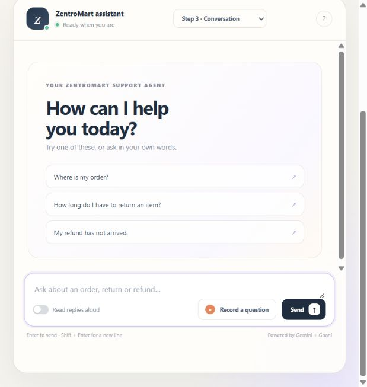
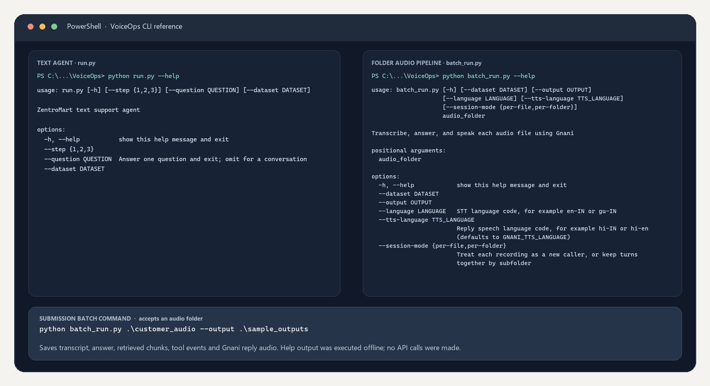
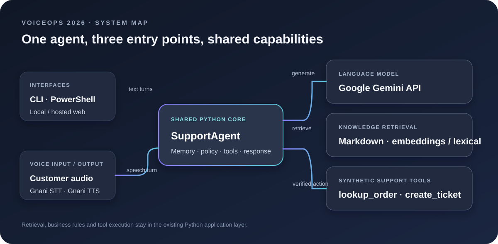
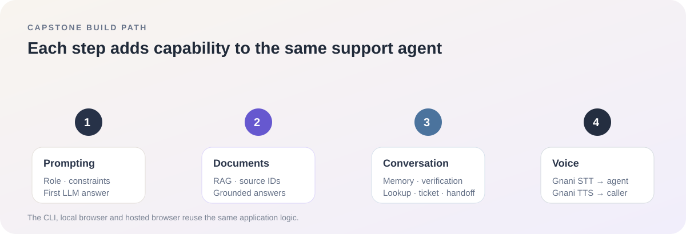
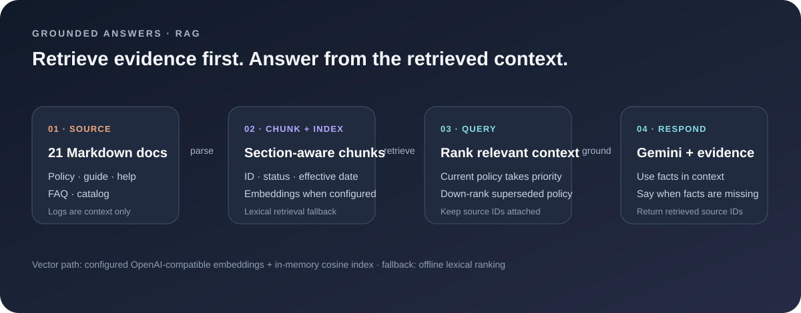
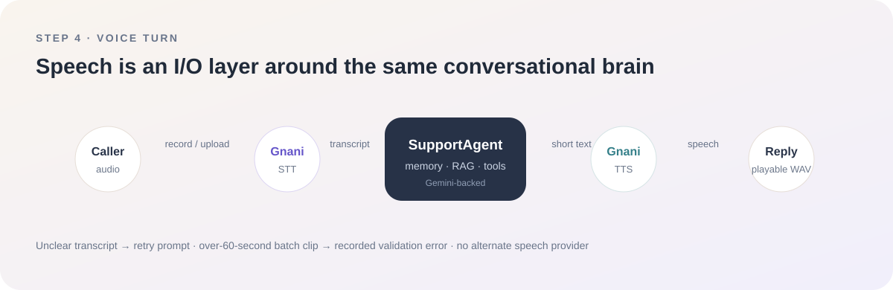
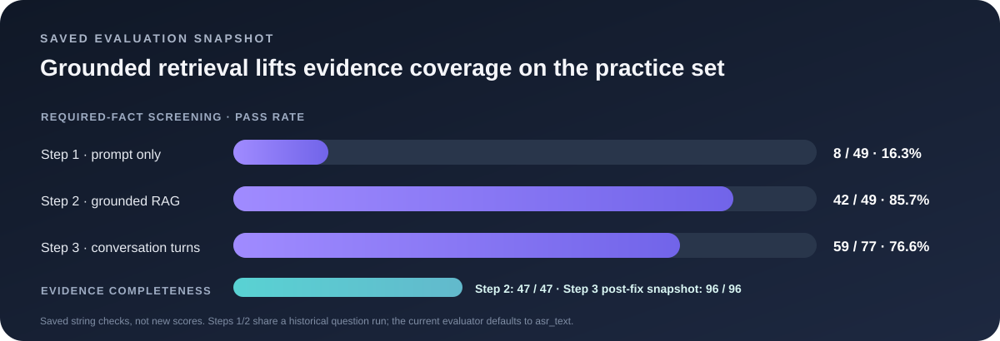

<div align="center">

# VoiceOps 2026
### ZentroMart · grounded support, built for voice

**A four-step customer-support agent that answers from policy documents, verifies orders with mock tools, remembers the conversation, and speaks through Gnani.**

[](https://www.python.org/)
[](https://ai.google.dev/)
[](https://gnani.ai/)
[](docs/capstone_report.md)

[Live demo](https://zentromart-voiceops.vercel.app/) · [Source code](https://github.com/vanshdixit1/zentromart-voiceops) · [Report](report.pdf) · [2-minute demo](demo.mp4)

</div>

<p align="center"></p>

<p align="center"><em>Actual production UI · ZentroMart assistant · text and microphone input · source-aware replies</em></p>

### PowerShell / CLI workflow

The repository also runs from PowerShell: use `run.py` for text conversations and `batch_run.py` to process an audio folder. This terminal reference uses the actual `--help` output from both commands; the batch call is the one-folder submission entry point.



## What it does

VoiceOps is a customer-support capstone for fictional Indian retailer ZentroMart. It keeps one Python agent behind the PowerShell/CLI workflow, local website, and hosted website.

- **Grounded support:** indexes 21 Markdown knowledge-base files; retrieves policy sections and returns their source IDs with each answer.
- **Safe order actions:** uses the supplied order lookup and ticket tools. Caller verification is required before order details are disclosed.
- **Conversation memory:** carries the issue and verified state across turns, asks for missing details, and can hand decisions to a human.
- **Voice:** Gnani is the only speech provider for STT and TTS; empty transcripts recover with a retry prompt.
- **Evaluation:** runs the supplied question set and ordered conversation cases, recording retrieved evidence and tool-call checks.
- **Two interfaces, one agent:** the web UI and CLI both call the same Python `SupportAgent` implementation.

## System design

### Architecture



### Capstone workflow



### Retrieval-augmented generation



### Voice turn



## Evaluation snapshot

The full Step 1/2 figures below are a fresh run on the brief's `asr_text` field: all 52 questions per step, 104 Gemini responses, with 4.1-second request spacing. The earlier `question`-field results remain in [docs/evaluation_snapshot.json](docs/evaluation_snapshot.json) as historical context. The project owner has completed manual review of paraphrase-sensitive results; table scores remain the evaluator's literal-match checks. Conversation checks use all 96 supplied turns in the saved post-fix run.

| Saved run | Cases | Required facts | Evidence complete | Tool calls match | Other checks |
|---|---:|---:|---:|---:|---|
| Step 1 · prompt only (`asr_text`) | 52 questions | 10 / 49 (20.4%) | 0 / 47 (no RAG) | 52 / 52 (100%) | 52 / 52 avoided forbidden claims and hard negatives |
| Step 2 · grounded RAG (`asr_text`) | 52 questions | 29 / 49 (59.2%) | 47 / 47 (100%) | 52 / 52 (100%) | 52 / 52 avoided forbidden claims and hard negatives |
| Step 3 · conversations, post-fix saved snapshot | 96 turns | 59 / 77 (76.6%) | 96 / 96 (100%) | 96 / 96 (100%) | 96 / 96 forbidden-claim and hard-negative checks |

### Earlier three-case `asr_text` diagnostic pilot

Before the full run, the first three practice IDs were used to diagnose spoken-SKU warranty, wallet refund timing, and an unsupported delivery-slot question. The Step 2 recheck after fixes scored **3/3 required facts, 2/2 gold-evidence checks, 3/3 hard-negative checks, and 3/3 tool-call checks**. That earlier pilot is diagnostic only; it is not the final full-set score. Details are in [docs/evaluation_snapshot.json](docs/evaluation_snapshot.json).

Run a similarly small sample with `python evaluate.py --dataset dataset --steps 1 2 --limit 3 --output reports/asr-pilot.jsonl`. The limit caps questions per step; if Step 3 is selected, it also limits to the first three complete conversations, preserving every turn in each.



The aggregate numbers are preserved in [docs/evaluation_snapshot.json](docs/evaluation_snapshot.json); generated per-case reports under `reports/` stay excluded from Git. The evaluation is reproducible with the supplied dataset and Gemini credentials. Review `evaluate.py` and `docs/capstone_report.md` for scoring limits and project context.

### Offline verification

| Check | Result |
|---|---|
| Offline Python tests | 38 tests run; 37 passed, 1 skipped because this environment blocks local socket connections |
| Dataset validator | Passed locally with `python validate_dataset.py` |
| Python line coverage | 81.1% (1,422 / 1,754 executable lines across 10 exercised first-party modules; built-in `trace`; branch coverage not measured) |
| Live Gemini / Gnani smoke | Three `asr_text` cases compared Step 1 and Step 2; one synthetic audio file completed Gnani STT → Gemini → Gnani TTS |
| Live website microphone check | Gnani transcribed a clear personal question; Gemini returned the expected order-ID prompt, retrieved sources were shown, and a six-second Gnani reply was available. The personal recording was not saved. |

## Quick start

### 1. Get the synthetic dataset

Download `Capstone_Project_Dataset_FTTT_2026.zip` from the capstone brief, extract it, and place the extracted folder here:

```text
dataset/Capstone_Project_Dataset_FTTT_2026/
```

The data is synthetic and intentionally kept out of this repository. Start with the archive's `README.md` and `DATA_DICTIONARY.md`.

### 2. Install and configure

```powershell
python -m venv .venv
.\.venv\Scripts\Activate.ps1
python -m pip install -r requirements.txt
Copy-Item .env.example .env
```

Edit `.env` and set `GEMINI_API_KEY`, `GEMINI_MODEL`, and `GNANI_API_KEY` for the services you plan to use. Keep `.env` private; it is ignored by Git. Optional Gemini fallback and embedding settings are documented in `.env.example` and the detailed setup below.

### 3. Validate and run

```powershell
python validate_dataset.py
python run.py --step 2 --question "Can I cancel an order that has shipped?"
```

Run the browser interface with `python web_app.py`, then open <http://127.0.0.1:8000>. Start the same conversational agent in the terminal with `python run.py --step 3`.

For the batch voice workflow, pass a folder of permitted audio recordings:

```powershell
python batch_run.py .\customer_audio --output .\sample_outputs
```

See **[README setup and usage](#setup-and-usage)** below for all commands, environment variables, and hosted deployment details.

## Setup and usage

### Prerequisites

- Python 3.10 or newer and PowerShell on Windows.
- The capstone dataset ZIP, extracted under `dataset/` as shown above.
- Gemini API key for generated answers; Gnani API key for live speech input/output.

If PowerShell activation is restricted, install with `\.venv\Scripts\python.exe -m pip install -r requirements.txt`, and use `\.venv\Scripts\python.exe` instead of `python` in the commands below.

### Configuration

Copy `.env.example` to `.env`. Set `GEMINI_API_KEY` and `GEMINI_MODEL` for Google AI Studio. The optional `GEMINI_FALLBACK_API_KEY` is tried once after quota/rate-limit errors; use a key from a different Google project. Timeouts are not automatically retried. `GEMINI_MIN_REQUEST_INTERVAL_SECONDS` spaces requests to respect configured free-tier limits.

Set `GNANI_API_KEY` for Step 4. STT/TTS language, TTS model, and voice are configurable; Gnani is the only speech provider. The optional OpenAI-compatible endpoint is used only for embeddings. If it is unavailable or not configured, the unchanged retrieval implementation falls back to lexical search.

Never commit `.env`, API keys, dataset copies, real customer data, or generated customer recordings.

### Run modes

```powershell
# Step 1: prompt-only LLM answer
python run.py --step 1 --question "How long do I have to return an item?"

# Step 2: answer grounded in retrieved documents
python run.py --step 2 --question "How long do I have to return an item?"

# Step 3: conversational agent with order/ticket tools
python run.py --step 3

# Run the web application
python web_app.py

# Validate the extracted dataset
python validate_dataset.py

# Evaluate supplied practice cases (uses Gemini API; consumes quota)
python evaluate.py --dataset dataset --steps 1 2

# Process audio files through Gnani STT → agent → Gnani TTS
python batch_run.py .\customer_audio --output .\sample_outputs
```

Each batch item saves transcript, text reply, retrieved source/chunk records, tool events, and spoken WAV output. Files over 60 seconds are rejected. Use personal or consented recordings only; the dataset contains no audio.

### Hosted demo and redeployment

Try the [hosted VoiceOps app](https://zentromart-voiceops.vercel.app/). The public site can consume configured Gemini and Gnani quotas. Production credentials are configured in Vercel and are not stored in this repository.

For a fresh deployment, extract the dataset locally, run `python build_deploy_bundle.py`, and deploy the generated `voiceops_bundle.zip` with `api/index.py`, `requirements.txt`, and `vercel.json`. Configure production environment variables in Vercel before deploying. The dataset and generated bundle are ignored by Git.

## Repository map

```text
src/voiceops/       Shared Python agent, configuration, RAG, data and Gnani adapters
web/                Responsive chat interface and browser microphone capture
web_app.py          Local web server using the shared agent
run.py              PowerShell-friendly CLI / conversation entry point
batch_run.py        Audio-folder batch runner and output writer
evaluate.py         Question and multi-turn practice evaluator
validate_dataset.py Dataset schema, join, policy and tool-contract checks
tests/              Offline unit and workflow tests with mocks
docs/media/         Architecture, RAG, workflow, voice and evaluation visuals
docs/               Architecture notes, report and demo guidance
report.pdf          Capstone report
demo.mp4            Recorded capstone demonstration
```

<details>
<summary><strong>Implementation notes</strong></summary>

- Gemini uses Google's official `google-genai` SDK. Conversation tool behavior remains in the existing agent/tools layer.
- Markdown sections preserve IDs and policy metadata. The in-memory cosine index uses the existing embedding interface; lexical retrieval remains available as fallback.
- The supplied `lookup_order` tool requires order ID plus one verification proof (phone suffix or delivery pincode) before revealing order details.
- Gnani handles both speech directions. Empty/unclear transcripts return a retry response; TTS model and voice are explicit configuration.
- Data and knowledge files are loaded from the supplied archive at runtime; they are not duplicated into this repository.

</details>

## Credits

VoiceOps 2026 capstone · Consulting & Analytics Club, IIT Guwahati × Gnani.ai. Built by **Vansh Dixit**.
